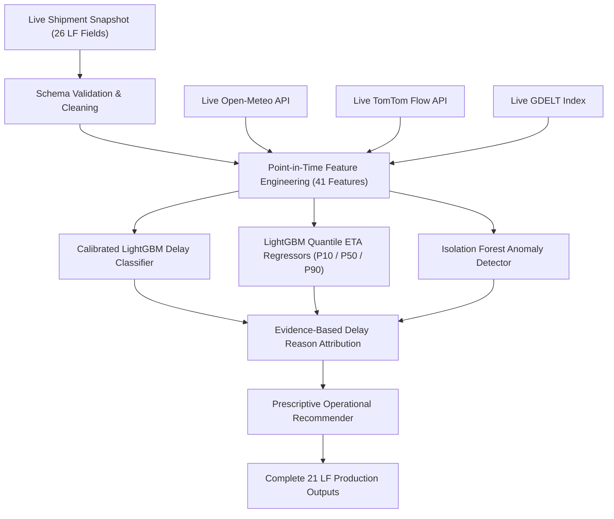

# Logi Freight — Logistics Forecasting System

[](https://www.python.org/downloads/)
[](https://opensource.org/licenses/MIT)

**Logi Freight** is a production-grade, multi-task Machine Learning system built for real-time logistics tracking, delivery SLA risk prediction, quantile arrival forecasting, and automated root-cause delay attribution.

---

## 1. System Overview & Architecture

Logi Freight accepts live shipment telemetry snapshots, fuses real-time external environmental signals (**Open-Meteo Weather**, **TomTom Traffic Flow**, and **GDELT Civic Disruptions**), and executes a calibrated multi-task ensemble to return **exactly 21 standardized output fields**:



---

## 2. The 21 LF Output Contract

Every live prediction strictly returns the following 21 fields:

| Output Field | Type | Description |
|---|---|---|
| `Consignment_Number` | String | Shipment Tracking Identifier |
| `As_Of` | ISO Datetime | Point-in-time prediction timestamp |
| `Stage` | String | Operational stage (`IN_TRANSIT`, `MANIFEST`, etc.) |
| `Current_Location` | String | Last known geographical checkpoint |
| `Latitude` | Float | Vehicle latitude |
| `Longitude` | Float | Vehicle longitude |
| `Delay_Risk_Percentage` | Float | Calibrated delay probability ($0.0 - 100.0\%$) |
| `Risk_Level` | String | Risk tier (`LOW`, `MEDIUM`, `HIGH`, `CRITICAL`) |
| `Revised_ETA` | ISO Datetime | Point prediction (P50 Median expected arrival) |
| `ETA_Earliest_P10` | ISO Datetime | Optimistic 10th percentile arrival time |
| `ETA_Latest_P90` | ISO Datetime | Conservative 90th percentile arrival time |
| `Current_ETA` | ISO Datetime | Target delivery SLA deadline |
| `Elapsed_Frac` | Float | Fraction of planned SLA duration consumed |
| `Behind_Pace` | Boolean | True if vehicle required speed exceeds limits |
| `Remaining_KM` | Float | Estimated remaining downstream road distance |
| `ETA_Confidence` | Float | Confidence score based on P10-P90 interval width |
| `Anomaly_Flag` | Boolean | True if abnormal dwell or speed drop detected |
| `Delay_Reason` | String | Evidence-based root cause (`ON_TRACK`, `SEVERE_WEATHER`, `TRAFFIC_CONGESTION`, etc.) |
| `Recommended_Action` | String | Prescriptive actionable operational guidance |
| `Delay_Prediction` | String | Categorical SLA classification (`ON_TIME` / `DELAYED`) |
| `Predicted_Status` | String | Detailed status (`ON_TIME`, `DELAYED`, `SEVERELY_DELAYED`) |

---

## 3. Installation & Quick Start

### Step 1: Install Dependencies
```bash
git clone https://github.com/your-org/Logi_Freight.git
cd Logi_Freight
pip install -r requirements.txt
```

### Step 2: Run Live Prediction on a Sample Snapshot
```bash
python scripts/predict_live.py --input examples/sample_input.json --output output.json
```

### Step 3: Run Batch Prediction on a New CSV Dataset
To process a complete incoming LF dataset (e.g. `future_lf_data.csv`) without retraining:
```bash
python scripts/predict_live.py --input data/raw/future_lf_data.csv --output predictions.csv
```

### Step 4: Run Automated Test Suite
```bash
pytest tests/
```

---

## 4. Benchmark Performance Summary

| Benchmark Partition | Accuracy | ROC-AUC | F1-Score | Recall | ETA MedAE | Monotonicity ($P10 \le P50 \le P90$) |
|---|---|---|---|---|---|---|
| **Historical Holdout Test (May–Sep 2025)** | **`95.39%`** | **`0.9887`** | **`0.8989`** | **`86.81%`** | **`3.29 hours`** | **100.0% Verified** |
| **External Real-World Test (live data test- ct)** | **`92.50%`** | **`0.9700`** | **`0.9302`** | **`100.00%`** | **`6.15 hours`** | **100.0% Verified** |

---

## 5. Configuration & External APIs

Configuration is managed in `config.yaml`. To enable real-time TomTom Traffic Flow querying, set your environment variable:

```bash
export TOMTOM_API_KEY="your_api_key_here"
```

*(If the key is omitted or the network is unavailable, Logi Freight automatically and gracefully falls back to calibrated corridor baseline flow without interrupting predictions).*

---

## 6. Directory Structure

```
Logi_Freight/
├── README.md               # Main documentation
├── requirements.txt        # Package dependencies
├── config.yaml             # Thresholds and API configurations
├── PACKAGE_MANIFEST.md     # Package inventory
├── data/                   # Raw & processed data directories
├── src/                    # Modular source code
├── models/                 # Pretrained model artifacts & metadata
├── tests/                  # Automated pytest suite
├── scripts/                # CLI runners for inference, training & evaluation
├── examples/               # Sample JSON inputs & outputs
└── reports/                # Model card and performance metrics
```
